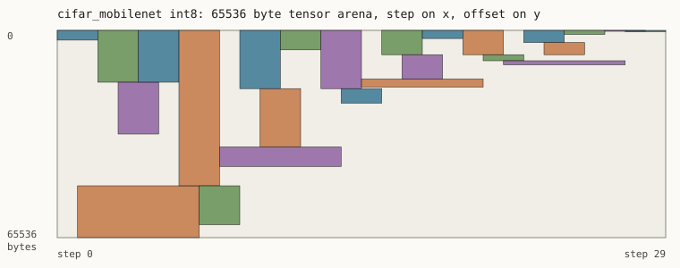
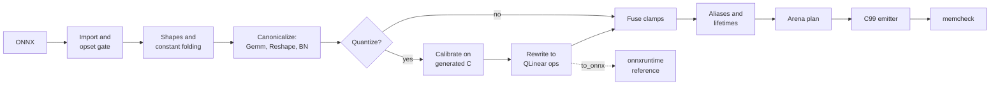

# onnxcc

[](https://github.com/matejpopovski/onnxcc/actions/workflows/ci.yml)

An ahead-of-time compiler from ONNX to one self-contained C99 file. The output has no malloc, no
runtime and no libc calls: every tensor has a fixed place in a static arena, decided at compile
time, and the only header it includes is `<stdint.h>`. Models can be quantized to int8 on the way
through.

Two models trained for this repo, compiled and measured:

| | `fashion_cnn` | `cifar_mobilenet` |
|---|---|---|
| Dataset, test images | Fashion-MNIST, 10,000 | CIFAR-10, 10,000 |
| Parameters | 47,130 | 83,722 |
| Top-1, float, onnxruntime | 92.13% | 84.28% |
| Top-1, float, generated C | 92.13% | 84.28% |
| Top-1, int8, generated C | 92.02% | 84.29% |
| Static RAM, int8 | 18.4 kB | 68.0 kB |
| Same, one array per tensor | 30.0 kB | 266.8 kB |
| Cortex-M4F `.text`, int8, `-Os` | 1,696 bytes | 2,612 bytes |
| Cortex-M4F `.rodata` (weights, parameters), int8 | 49,288 bytes | 102,432 bytes |
| Cortex-M4F `.bss`, int8 | 18,816 bytes | 69,632 bytes |

Sizes are from `arm-none-eabi-size` on the object file. There is no hardware measurement in this
repo; see [Cortex-M4](#cortex-m4) for what was and was not measured.



Each box is one tensor: its width is how long it stays live, its height how many bytes it needs.
No two boxes overlap, and that claim is checked by code that shares nothing with the planner.

## Using it

```sh
uv sync
uv run onnxcc compile models/fashion_cnn.onnx -o fashion.c --name fashion --header
```

```text
entry point              fashion_run
steps                    8
static RAM               62720 bytes, 0 of it scratch
live peak (lower bound)  62720 bytes
without planner          107200 bytes
constants                188136 bytes
kernels                  conv2d_f32, dense_f32, maxpool_f32
```

The result builds with any C99 compiler, and the header is optional:

```c
#include "fashion.h"

float image[FASHION_IN0_ELEMENTS];   /* 1x1x28x28, normalized as in training */
float logits[FASHION_OUT0_ELEMENTS];
fashion_run(image, logits);
```

To quantize, pass calibration inputs as an `.npz` with one array per model input, each with a
leading sample axis. `--int8-io` also removes the float conversions at the interface, and the
header then exposes the scale and zero point of each input and output.

```sh
uv run onnxcc compile model.onnx -o model.c --quantize calibration.npz --int8-io --header
uv run onnxcc verify model.c
```

The body of the generated entry point reads like hand-written firmware. This is the int8
`fashion_cnn`, abridged:

```c
void fashion_run(const float *restrict in0, float *restrict out0)
{
    /*@ 0 QuantizeLinear w=Q[12544:13328]:v0 r=in0[0:784]:v1 */
    ox_quantize_s8(Q + 12544, in0, 784, 0x1.6c073ap-7f, -55);
    /* node_Conv_50 */
    /*@ 1 QLinearConv w=Q[0:12544]:v2 r=Q[12544:13328]:v0 */
    ox_qconv2d_s8(Q + 0, Q + 12544, W5, W3, W1, W2, S, &P4, -55, -128);
    /* node_max_pool2d */
    /*@ 2 MaxPool w=Q[12544:15680]:v3 r=Q[0:12544]:v2 */
    ox_maxpool_s8(Q + 12544, Q + 0, &P6);
    ...
```

## How it works



Shape inference and constant folding are one pass, because each needs the other: PyTorch computes
`Reshape` targets through `Shape` and `Gather`, and `Shape` folds only once the shapes are known.
Canonicalization then deletes kernels. `Flatten`, `Squeeze`, `Identity` and `Dropout` all become
`Reshape`. `Gemm` and `MatMul` become one matrix product with an optional bias. 1-D windows go
through the 2-D kernels. `BatchNormalization` merges into the preceding weights, or becomes a
`Mul` and an `Add` when it cannot.

The emitter copies only the kernels a model uses out of [`kernels.c`](src/onnxcc/kernels.c), which
is why int8 `fashion_cnn` costs 1,696 bytes of code.

## Why this is harder than printing loops

**An arena is a strict-aliasing trap.** The obvious design is one byte array with tensors cast out
of it. C99 makes that undefined: an object declared as `unsigned char[]` keeps that effective type,
so reading it through `float *` is not allowed, and reusing a slot for another type is worse.
`-fno-strict-aliasing` would hide the problem but it would be a requirement on every firmware build
that consumes the file. onnxcc keeps one typed array per element type (`float F[]`, `int8_t Q[]`)
and plans them separately. The cost is that a float tensor and an int8 tensor can never share
memory, which is negligible because a model is almost entirely one or the other.

**Shared memory has to be safe, not merely small.** A `Reshape` output is the same bytes as its
input, so it costs no memory and emits no code. An element-wise op may overwrite an input that dies
at that step, which is why those kernels have no `restrict`. Both decisions are folded into storage
records before the planner runs, so the planner only sees intervals and could be fuzzed on its own.

**Planning is NP-hard, but only has to run once.** Arena minimization is dynamic storage allocation.
onnxcc runs five orderings of first-fit, each a few lines, and keeps the best, then reports the
lower bound (the most bytes live at any step) next to the result. On both models the plan meets
that bound, so it is optimal for the schedule. On 1,000 random 7-buffer instances solved
exactly by exhausting orderings, it was optimal 98.60% of the time, and 1.155 times optimal
in the worst case ([`planner_gap.json`](results/planner_gap.json)). Rejected: an ILP. It would add a
solver dependency to save nothing on these graphs.

**Weights must survive printing.** Decimal literals round-trip only with care and cost more bytes.
Constants are emitted as C99 hex floats, exact to the bit, and non-finite weights are a compile
error since C99 has no literal for them without `<math.h>`.

**No libm.** `exp`, `tanh` and `softmax` use single-precision Cephes polynomials in the kernel file.
Measured error against double-precision numpy over 100,001 points is below 3e-7 relative
([`test_numerics.py`](tests/test_numerics.py)). A stray `double` would drag soft-float into a
Cortex-M4F build, so the code uses `f`-suffixed literals only, enforced by `-Wdouble-promotion` and
an assembly check for `__aeabi_d*`.

**Compilers insert libc behind your back.** `int32_t idx[8] = {0}` compiled to a call to `memset`
under `arm-none-eabi-gcc -Os`, which the cross-compile test caught as an undefined symbol. Kernels
now clear such arrays in a loop. Under `-ffreestanding -fno-builtin`, with
`-fno-tree-loop-distribute-patterns` on gcc, objects have no undefined symbols at all. Without
those flags a compiler may still turn a loop into `memset` or `memcpy`, which any firmware libc
provides.

**Int8 needs an accumulator proof.** Convolution accumulators are `int32_t`. For each channel the
compiler sums `|w| * 255 + |bias|` and refuses the model if that can exceed `INT32_MAX`, so overflow
is excluded before the code exists, and not merely unobserved under UBSan.

**Calibration runs the shipped kernels.** Ranges are collected by compiling the float model with
an observer hook and running that binary, so calibration needs a C compiler and no Python
reimplementation of every operator.

**Convolution form was measured, not assumed.** The first int8 kernel used a per-pixel gather loop,
which needs no scratch memory. Under QEMU it executed more than twice the instructions of the
current one, measured during development on `fashion_cnn`; that kernel is no longer in the tree, so
the figure is not reproducible here. The current kernel uses the same scatter form as the float
kernel, with a scratch plane of `int32_t` accumulators, which costs 3,136 bytes of RAM on that model.

## How it is checked

| Claim | Check | Independent of |
|---|---|---|
| Each operator is correct | 245 golden cases against onnxruntime; a test fails if a supported op has none | the kernels |
| No live tensors overlap | `memcheck` replays the emitted C over a shadow arena: every write stamps its region, every read must find its own stamp | planner, liveness |
| The planner is sound | property tests on random intervals, judged by `check_intervals` | planner |
| The checker can fail | it must reject corrupted plans; mutated C is rejected and also computes wrong numbers | the checker's own verdict |
| Plans work on real graphs | random operator DAGs, compared to onnxruntime and to a build with no sharing | planner, emitter |
| No memory or UB errors | ASan and UBSan on a build with one array per tensor, so ASan sees tensor boundaries, not just the arena's | the arena |
| Int8 kernels are correct | fixed-point C within one step of onnxruntime's float-based requantization | fixed-point code |
| Quantization is correct | the quantized graph is exported to ONNX and run in onnxruntime as a reference | quantizer's kernels |

[`memcheck.py`](src/onnxcc/memcheck.py) imports nothing from the compiler, and a test parses its
AST to keep it that way. It reads only the generated text, and it first checks that each `/*@ */`
annotation matches the pointers in the statement after it. It has no concept of a lifetime, so a
liveness bug and a planner bug fail the same way: a read finds someone else's stamp. `S`, the int8
scratch plane, is outside its model: no value survives in it between steps.

Warnings are errors with `-std=c99 -Wall -Wextra -Wpedantic -Wconversion -Wshadow
-Wdouble-promotion -Wstrict-prototypes -Wvla`. The CI workflow runs the suite under sanitizers with
gcc on Ubuntu and the default `cc` on macOS, and the C-facing tests with clang on Ubuntu. Locally it
also ran with Apple clang on arm64, on x86-64 under Rosetta with an x86-64 onnxruntime, and with
GCC 15, which has no sanitizer runtime on macOS arm64.

34,360 property-test cases passed with fresh random seeds and 0 failed
(`uv run python -m experiments.fuzz_campaign`, [`fuzz_campaign.json`](results/fuzz_campaign.json)).
CI runs the same properties with a fixed seed and a smaller budget.

Fuzzers need checking too. The first graph fuzzer generated short graphs and passed a long campaign
while two quantizer bugs sat in the code: a value reshaped after a float op had no calibration data,
and `Clip(0.5, 1)` was dropped because int8 saturation cannot exclude zero. Reading the code found
both. Measuring the fuzzer's operator histogram then showed why it had missed them, and the rewrite,
which biases toward recent tensors and longer programs, immediately exposed a third bug in the ONNX
exporter. All three have regression tests in [`test_quantize.py`](tests/test_quantize.py).

## Results

All of it regenerates from a clean clone once `data/` is populated. Host numbers are from an Apple
M3 Max with 36 GB of RAM, on a machine shared with other jobs at the time.

```sh
uv sync --group train
uv run --group train python -m experiments.train fashion_cnn      # about 4 min on 4 CPU threads
uv run --group train python -m experiments.train cifar_mobilenet  # about 60 min on 4 CPU threads
uv run python -m experiments.evaluate     # results/accuracy.json
uv run python -m experiments.memory       # results/memory.json, docs/arena_*.svg
uv run python -m experiments.latency      # results/latency.json
uv run python -m experiments.embedded     # results/embedded.json, needs arm-none-eabi-gcc
uv run python -m experiments.planner_gap  # results/planner_gap.json
```

Models are trained here on CPU with four threads, from scratch, and no pretrained weights are used.
The times above are from a machine under heavy load from other jobs.
Fashion-MNIST (MIT) and CIFAR-10 are downloaded to `data/`, which is not committed, apart from a
small Fashion-MNIST sample in `tests/data` with its licence.

### Accuracy

Calibration uses 1,000 training images and never touches the test set.

| Build | `fashion_cnn` | `cifar_mobilenet` |
|---|---|---|
| float, onnxruntime | 92.13% | 84.28% |
| float, generated C | 92.13% | 84.28% |
| int8, percentile 99.99, per-channel (default) | 92.02% | 84.29% |
| int8, min-max, per-channel | 91.96% | 84.45% |
| int8, percentile 99.99, per-tensor | 92.09% | 84.20% |
| int8, min-max, per-tensor | 92.05% | 84.07% |

Float C agrees with onnxruntime on every prediction, with a largest logit difference of
4.6e-06 on `fashion_cnn` and 5.7e-06 on `cifar_mobilenet`. Against onnxruntime running the same
quantized graph, int8 predictions agree on 99.97% and 99.40% of test images.

The int8 builds land within about 0.2 points of float, and a few on `cifar_mobilenet` come out
slightly above it. That is noise, not a gain: a change in rounding flips a handful of borderline
images either way. Differences this small do not separate the calibration or weight schemes, so
per-channel weights and percentile ranges are the default by convention, not because these two
models proved them better.

### Memory

Static RAM in bytes, including int8 scratch.

| Model | Plan | One array per tensor | Reduction | Live peak |
|---|---|---|---|---|
| `fashion_cnn` float32 | 62,720 | 107,200 | 1.71x | 62,720 |
| `fashion_cnn` int8 | 18,816 | 30,730 | 1.63x | 18,816 |
| `cifar_mobilenet` float32 | 262,144 | 1,064,064 | 4.06x | 262,144 |
| `cifar_mobilenet` int8 | 69,632 | 273,194 | 3.92x | 69,632 |

On all four builds the plan equals the live peak, so no placement can do better for this schedule.
Greedy-by-size reached that bound on every build. Other orderings are not interchangeable: on the
int8 MobileNet two of them need 77,824 bytes of tensor arena instead of 65,536
([`memory.json`](results/memory.json)).

In-place reuse changed nothing on these models, because their peaks fall on convolutions, which
cannot share storage. The test suite has a chain of element-wise ops where it halves the arena.

### Cortex-M4

Cross-compiled with arm-none-eabi-gcc 16.2.0 for `-mcpu=cortex-m4 -mfpu=fpv4-sp-d16 -mfloat-abi=hard`. Sizes are
from `arm-none-eabi-size -A` on the object file, at `-Os`.

| Model, build | `.text` | `.rodata` | `.bss` | Largest frame |
|---|---|---|---|---|
| `fashion_cnn` float32 | 1,356 | 188,520 | 62,720 | 176 |
| `fashion_cnn` int8 | 1,696 | 49,288 | 18,816 | 184 |
| `fashion_cnn` int8, `--int8-io` | 1,480 | 49,288 | 18,816 | 184 |
| `cifar_mobilenet` float32 | 1,840 | 329,616 | 262,144 | 184 |
| `cifar_mobilenet` int8 | 2,612 | 102,432 | 69,632 | 184 |
| `cifar_mobilenet` int8, `--int8-io` | 2,372 | 102,432 | 69,632 | 184 |

Each build also ran under QEMU 11.1.3 on the emulated MPS2 AN386 board, with the small bare-metal harness
in [`embedded/`](embedded). This is emulation, not hardware.

| Model, build | Instructions per inference, `-Os` | `-O2` | Stack high-water | Result vs host build |
|---|---|---|---|---|
| `fashion_cnn` float32 | 14.3 M | 13.9 M | 248 bytes | same predictions |
| `fashion_cnn` int8 | 21.0 M | 14.5 M | 272 bytes | bit-exact |
| `fashion_cnn` int8, `--int8-io` | 20.9 M | 14.5 M | 280 bytes | bit-exact |
| `cifar_mobilenet` float32 | 58.4 M | 57.5 M | 244 bytes | same predictions |
| `cifar_mobilenet` int8 | 89.7 M | 65.0 M | 296 bytes | bit-exact |
| `cifar_mobilenet` int8, `--int8-io` | 89.6 M | 64.9 M | 288 bytes | bit-exact |

The instruction counts come from QEMU's `-icount shift=0` mode, where one retired instruction
advances virtual time by 1 ns, read through the 25 MHz board timer, so they resolve to 40
instructions. A loop of known length confirmed that scale exactly. These are instruction counts,
not cycles: flash wait states, pipeline effects and FPU timing are not modelled, so no latency on a
physical part is claimed. Float builds differ from the host build by at most 2.4e-06 in a logit.

### Host latency: where this loses

Single thread, one image, median of 15 rounds, `-O3 -std=c99` against onnxruntime
1.31.1. onnxruntime's Python binding adds about 2.4 us per call, included below.

| Model | Generated C | onnxruntime | Ratio |
|---|---|---|---|
| `fashion_cnn` float32 | 362 us | 72 us | 5.0x slower |
| `fashion_cnn` int8 | 376 us | 37 us | 10.3x slower |
| `cifar_mobilenet` float32 | 951 us | 301 us | 3.2x slower |
| `cifar_mobilenet` int8 | 1,236 us | 118 us | 10.5x slower |

onnxruntime is faster on this host, by a wide margin on int8, and that is the expected result of
hand-written NEON kernels against plain C that a compiler has to vectorize. The rows of these
images are short too, which limits what auto-vectorization can gain. Matching it would take
per-architecture intrinsics, which would give up the property that one file builds unchanged on
any C99 target. What the generated code offers in exchange is size: `fashion_cnn` is 191,984
bytes of `__TEXT` on this host, weights included, against a 39 MB onnxruntime native library.

## Operators

Float: Abs, Add, AveragePool, BatchNormalization, Clip, Concat, Conv, Div, Dropout, Exp, Flatten,
Gemm, GlobalAveragePool, HardSigmoid, HardSwish, Identity, LeakyRelu, MatMul, Max, MaxPool, Min,
Mul, Neg, PRelu, Pad, ReduceMean, ReduceSum, Relu, Reshape, Sigmoid, Slice, Softmax, Split, Squeeze,
Sub, Tanh, Transpose, Unsqueeze.

Int8: QLinearConv, QLinearMatMul, QuantizeLinear, DequantizeLinear, and `com.microsoft` QGemm,
QLinearAdd, QLinearMul, QLinearAveragePool, QLinearGlobalAveragePool, QLinearConcat. MaxPool,
Reshape, Transpose, Slice, Pad and Clip also run on int8.

Compile time only: Cast, Constant, ConstantOfShape, Gather, Range, Shape, Size. They must fold,
apart from a no-op Cast. Some float operators with all-constant inputs fold too.

Opsets 13 to 23. `onnxcc compile` lists every unsupported operator at once and stops.

## Limitations

- **No control flow, no dynamic shapes.** `If`, `Loop` and `Scan` are rejected. A dynamic leading
  axis becomes 1, and any other dynamic axis needs `--input-shape`.
- **No recurrent layers, `ConvTranspose`, `Resize`, or 3-D convolution.** `Gather` must fold, and a
  runtime `Cast` is accepted only when it changes nothing.
- **Not re-entrant.** The arena is a set of file-scope statics, so one model cannot run in two
  threads or interrupt priorities at once. Two different models can link together, but each keeps
  its own arena: there is no sharing between them.
- **The caller's buffers must not overlap.** The entry point declares them `restrict`.
- **Schedule is taken from the file.** The planner places tensors for the node order it is given and
  does not search for a better topological order, which can lower the peak on branchy graphs.
- **In-place reuse did not lower the peak on either reporting model**, because their peaks fall on
  convolutions, which cannot run in place. It does help on chains of element-wise ops.
- **Int8 is int8.** Activations must be int8 and weights symmetric. Uint8 graphs and QDQ-format
  models are not pattern-matched into integer kernels: Q and DQ nodes run as written, so the op
  between them stays float.
- **No integer kernels for Softmax, Sigmoid, Tanh, or LeakyRelu.** The quantizer leaves them in float
  with `DequantizeLinear` around them, which `--int8-io` refuses at the graph's edges.
- **Int8 results are close to onnxruntime, not bit-identical.** Single operators stay within one
  quantization step, because fixed-point requantization and its float32 path round differently.
  Those steps add up over a whole model, as the prediction agreement above shows.
- **NaN behaviour is unspecified.** Clamps and `Max` do not propagate NaN the way every runtime does.
- **Host assumptions in the output:** two's-complement `int8_t` and `int32_t`, IEEE-754 single
  precision floats, and arithmetic right shift of negative values. The last is checked by `#error`.
- **Tests that compare int8 with onnxruntime limit weights to +/-63**, because its x86 kernels can
  saturate a 16-bit intermediate on full-range weights. Default quantization uses +/-127, and the
  accuracy table above was measured that way on arm64.
- **Nothing here has run on a physical microcontroller.**

## Layout

```text
src/onnxcc/      frontend, shapes, folding, passes, quantize, liveness, planner, codegen, kernels.c
src/onnxcc/memcheck.py   the independent verifier
tests/           golden cases, property tests, fuzzers, sanitizer runs
experiments/     training and every number in this file
embedded/        linker script and bare-metal harness for the QEMU MPS2 AN386
models/          the two trained models
results/         machine-generated JSON
```

```sh
uv sync --frozen
uv run --frozen pytest -n 4
```

MIT licence.
